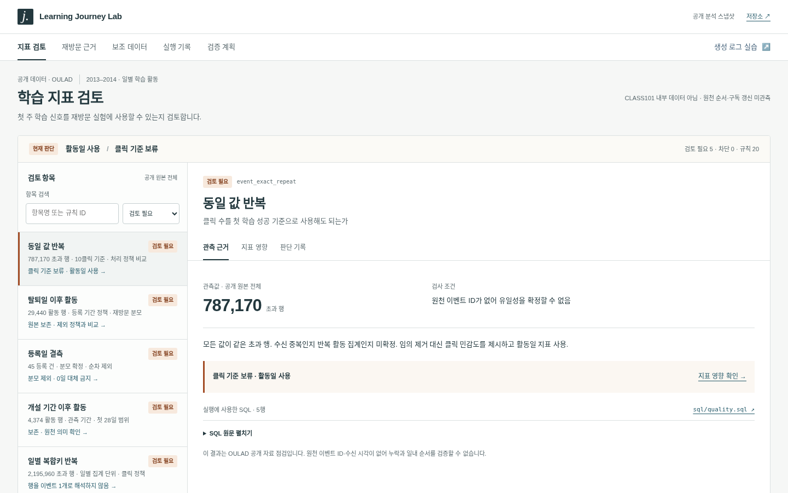
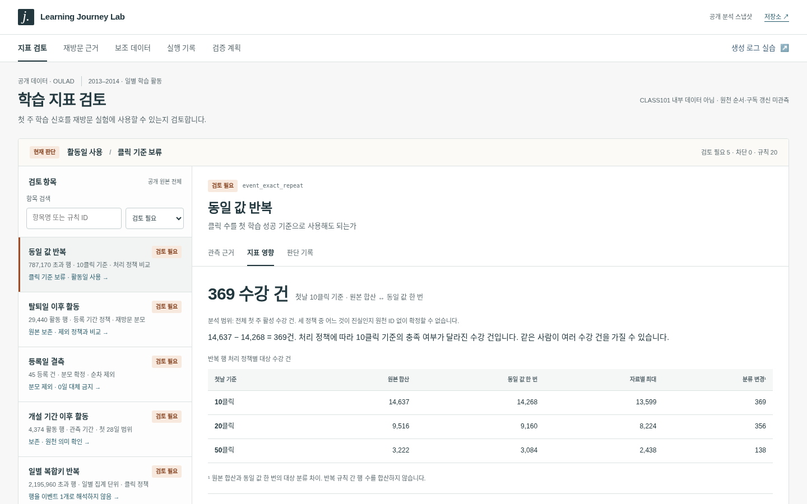
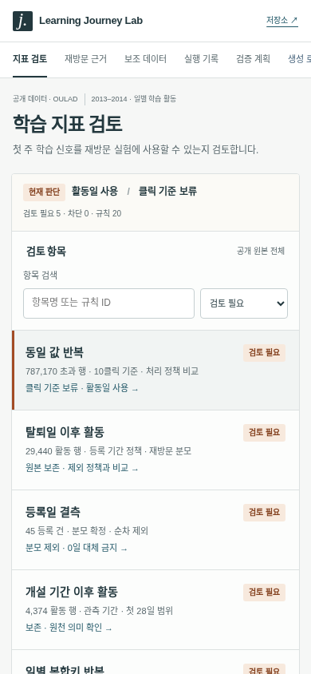

# Learning Journey Lab

**첫 주 학습 신호의 신뢰성을 점검하고, 다음 주 재방문 실험의 판단 근거를 만드는 분석·운영 도구.**

> CLASS101 제품전략팀 Data Analyst 지원을 위해 만든 독립 프로젝트입니다. CLASS101 내부 데이터·실제 서비스 실험·매출 성과를 포함하지 않습니다.

[공개 데모](https://learning-journey-lab.onrender.com) · [분석 결과](reports/findings.md) · [면접 설명·직접 실습](docs/interview-guide.md) · [검증 기록](docs/verification.md) · [화면·근거 모음](docs/portfolio-evidence.md) · [보완 결과와 남은 확인](docs/extension-summary.md)



## 문제와 판단

제품팀이 첫 학습 이후의 재방문을 개선하려면, 먼저 '학습했다'는 지표가 무엇을 의미하는지 확인해야 합니다. OULAD의 일별 활동 행에는 동일 키·동일 값 반복이 있으며, 이벤트 ID가 없어 모두 수집 오류라고 단정할 수 없습니다.

**클릭 수로 첫 학습 성공을 판정하는 안은 보류하고, 반복 행에 덜 민감한 활동일 지표로 재방문 실험 후보를 좁혔습니다.** 첫날 콘텐츠 접촉의 반대 근거와 판단할 수 없는 조건도 공개합니다.

<!-- BEGIN GENERATED FINDINGS -->
| 실제 측정 결과 | 의미 |
|---|---|
| 10,655,280 활동 행 / 28,785 고유 학습자 | 공개 원본 전체. 수강 등록은 32,593건 |
| 29,671 분석 수강 건 → 23,522 첫 주 활성 → 20,303 다음 주 재방문 | 재방문율 86.3% |
| 1일 활동 68.9% vs 2일+ 91.7% | 차이 +22.8%p, 95% 군집 구간 +21.5%p~+24.0%p |
| 동일 값 반복 초과 행 787,170개 | 오류 확정 아님. 첫날 10클릭 기준은 처리에 따라 369 수강 건 분류 변경 |
| 첫날 콘텐츠 접촉: 22개 개설기 중 9개가 반대 방향 | 전체 평균만으로 노출 확대 결론 보류 |
| 생성 실습: 60%처럼 보이는 행 지표, 실제 수신 학습자는 40% | 중복이 누락을 가림. 원천 재수집 뒤 기준 60% 복원 |
<!-- END GENERATED FINDINGS -->

숫자의 단위는 특별한 표시가 없는 한 **학습자×모듈×개설기의 수강 건**입니다. 같은 사람이 여러 건을 가질 수 있습니다. 관찰적 차이는 기능 개선의 인과 효과가 아닙니다.

## 3분 데모 경로

1. **지표 검토 → 동일 값 반복**: 관측 근거, 정확한 SQL 위치, 정책별 369건의 차이, 판단 기록을 연결합니다.
2. **재방문 근거**: 개설기를 선택하면 활동일·콘텐츠 접촉·표·차트에 같은 범위를 적용합니다. 전체 시점 재확인은 전체 범위에서만 표시합니다.
3. **실행 기록**: 실제 3회 실행 시간, 동일 결과 해시, 원본 스냅샷별 열린 이슈를 확인합니다.
4. **검증 계획**: 계측 조건→재개 진입점 실험→콘텐츠 확대 보류. 표본 계산은 미실행 설계의 보조 자료입니다.
5. **생성 로그 실습**: 공개 분석과 별도 화면에서 12명 장부의 중복·누락·재수집을 비교합니다.

PC는 검토 목록과 선택 상세, 모바일은 목록→상세→복귀 구조입니다. 개설기·검토 항목·상세 탭·실습 단계를 URL에 보존해 같은 근거를 공유할 수 있습니다. [UI 재조사](docs/research/ui-audit-2026-10-29.md)를 바탕으로 소개형 긴 페이지를 개편했습니다.



<details><summary>모바일 화면</summary>



</details>

정적 HTML/CSS/JS와 집계 JSON, 검증된 이슈·SQL·실행 기록을 제공합니다. 서버 분석 실행·실시간 로그 수집·알림 발송·로그인·LLM 호출은 없습니다. 화면의 버튼은 저장된 시나리오를 전환합니다.

## 추가 실제 데이터와 실행 검증

[EdNet 보조 분석 데모](https://learning-journey-lab.onrender.com/external.html) · [후보 조사](docs/data-sources.md) · [분석 정의·한계](docs/ednet-analysis.md)

OULAD를 유지하고 Santa의 실제 학습·유료 이용권 기록을 별도 분석했습니다. 두 서비스 결과를 합산하지 않습니다.

<!-- BEGIN EXTERNAL FINDINGS -->
- EdNet-KT4: 사전 해시 표본 **2,048명 / 854,678행**, 사용자별 제공 파일 전체.
- 문제 제출 ↔ 모든 이벤트(구매·환불 포함): 첫 주 **2일 이상 여부 23명**, 다음 주 기록 여부 **14명** 변경.
- 문제 제출 기준 다음 주 기록: 1일군 **31/1,688 (1.8%)**, 2일+군 **135/342 (39.5%)**. 관찰 종료가 불명확해 서비스 유지율로 해석하지 않음.
- 동일 값 반복 초과 **1,519행**, 동일 값 한 번 처리 시 활동 지표 변경 **0명**. 플랫폼 결측 **184행**은 구매·환불·쿠폰 기록에 집중.
- 구매 **173행/164명**, 환불 **5행/5명**. 가격·거래 ID·갱신·권한 원장이 없어 매출과 갱신율은 산출하지 않음.
- SQL과 독립 pandas 계산 **2,048명** 일치. 실제 파일 해시·ZIP CRC 검증, 동일 캐시 분석 2회 결과 일치.
<!-- END EXTERNAL FINDINGS -->

EdNet은 **CC BY-NC 4.0, 연구 목적**입니다. 원본 이력은 재배포하지 않으며 해당 집계에도 출처와 이용 조건을 표시합니다. OULAD 집계(CC BY 4.0) 및 코드(MIT)와 구분합니다.

실험 입력 검사는 합성 배정·이벤트로 관찰 경계, 교차군 배정, 지연·watermark, SRM, 가드레일을 실행 검증합니다. **실제 실험 참여자 0명, 실제 효과 미측정**. [계약과 18개 모집 시나리오](docs/experiment-readiness.md)를 함께 제공합니다.

[수작업·자동 채움 비교 화면](https://learning-journey-lab.onrender.com/operations-practice.html)은 같은 규칙 3개의 결과 기록·대조를 비교합니다. 지원자 1명이 각 방식 3회 수행한 원본 JSON을 검증했습니다. 작업 구간 중앙값은 **수동 A 40.27초 / 자동 채움 B 14.20초**, 관측 차이 **26.06초**이며 두 방식 모두 기록 오류·누락·미확인 0건입니다. 안내·반복 학습·고정 순서·중간 코드 실습의 영향을 분리할 수 없어 회사 생산성이나 전체 분석 시간 절감으로 일반화하지 않습니다. [실제 결과·한계·재현](docs/human-comparison-results.md) · [비교 조건](docs/human-comparison-protocol.md) · [지원자의 실제 참여 기록](docs/participation.md).

## 데이터와 분석 계약

| 자료 | 출처·라이선스 | 사용 범위 |
|---|---|---|
| 실제 공개 자료 | [OULAD / Open University](https://research.stem.open.ac.uk/ouanalyse/open-dataset-more/), [UCI](https://doi.org/10.24432/C5KK69), CC BY 4.0 | 2013–2014 일별 VLE 클릭·등록·콘텐츠 키. 7 CSV의 해시를 고정 |
| 완전 생성 자료 | `src/journey/faults.py`, [생성 장부](data/synthetic/) | 중복·누락·지연·잘못된 키·시점 역전 재현. 실제 데이터와 결합하지 않음 |

인용: Kuzilek J., Hlosta M., Zdrahal Z. (2017). *Open University Learning Analytics dataset*. [doi:10.1038/sdata.2017.171](https://doi.org/10.1038/sdata.2017.171). 공개 결과에는 집계·변환이 적용됐습니다. 원본 익명 사용자 행은 저장소에 재배포하지 않습니다.

- D0는 **개강일**. W1=D0–6, W2=D7–13, 후속=D14–27. 서비스 가입/결제일이나 첫 재생일이 아닙니다.
- 등록일 결측·개강 후 등록·개강 전 탈퇴를 순차 제외. 사후 탈퇴자로 분모를 줄이지 않습니다.
- 유효 양수 클릭의 고유 활동일로 활성 여부 계산. 결측을 0일로 임의 보정하지 않습니다.
- 2013 탐색과 2014 재확인 분리. 2013 원본 등록 이력이 있는 학습자를 재확인에서 제외합니다.
- 반복 수강의 의존성을 반영해 **학습자 단위 군집 부트스트랩** 사용. 개설기·시작일·클릭 처리·등록 기간 정책을 민감도로 비교합니다.
- DiD/DoubleML은 필요한 인과 가정과 처치 정보가 없고, SHAP은 설명할 예측 모델이 없으며, Markov는 전이 가정이 뒷받침되지 않아 사용하지 않았습니다.

상세 분자·분모·SQL 정책·편향: [데이터 계약](docs/data-contract.md). 대안 데이터·서비스·경쟁 프로젝트 조사: [조사 기록](docs/research/sources.md).

## 재현

Python **3.12**, Git, 약 1GB 디스크와 2GB 이상 여유 메모리를 권장합니다. 원본 ZIP은 약 47MB이고 CSV는 약 443MB입니다. 다운로드와 의존성 설치 뒤 핵심 분석은 오프라인으로 실행됩니다.

```bash
git clone https://github.com/sokldjs554/learning-journey-lab.git
cd learning-journey-lab
python3.12 -m venv .venv
source .venv/bin/activate
pip install -r requirements.txt
python -m pytest -q
python scripts/download.py
python scripts/analyze.py
python scripts/crosscheck.py
python scripts/build.py
python scripts/document.py
python scripts/verify.py
python -m http.server 8766 --directory web
```

Windows에서는 가상환경 활성화를 `.venv\Scripts\Activate.ps1`로 바꾸면 됩니다. 브라우저에서 `http://localhost:8766`를 엽니다. 다운로드에 실패하면 원본 없이 분석할 수 없으며 생성 자료로 자동 대체하지 않습니다. 캐시된 원본이 다르면 덮어쓰지 않고 종료합니다.

```bash
# 브라우저 검증 (서버가 실행 중인 별도 터미널)
pip install -r requirements-browser.txt
python -m playwright install chromium
python tests/browser_check.py --url http://localhost:8766
python tests/workbench_check.py --url http://localhost:8766
python tests/report_contract_check.py --url http://localhost:8766
python tests/review_regressions.py --url http://localhost:8766
npm install --prefix work/a11y axe-core@4.11.0
python tests/accessibility_check.py --url http://localhost:8766
```

스크린 리더 사용자 테스트나 모든 OS·브라우저 인증을 의미하지 않습니다. 전체 분석은 `python scripts/analyze.py`, 손계산 가능한 생성 실습은 테스트 또는 데모로 확인할 수 있습니다. 출처 해시: [manifest](data/manifest.json).

### 추가 근거 재현

```bash
python scripts/download_ednet.py
PYTHONPATH=src python -m journey.ednet
python scripts/check_experiment.py
python scripts/build.py
python scripts/verify.py
```

EdNet 다운로드는 공식 ZIP의 색인과 선정 사용자 파일에 필요한 범위만 받습니다. 약 162MB 전송·40MB 사용자 CSV이며, 원본 ZIP 전체 해시를 검증했다고 주장하지 않습니다. 다운로드 서버 접근 실패 또는 스냅샷 불일치 시 종료합니다. 실제 수신·검사 범위는 [고정 스냅샷](data/ednet_snapshot.json)과 [검증 기록](reports/ednet_verification.json)을 참조하세요. `PYTHONPATH` 표기는 bash 기준이며 Windows PowerShell에서는 먼저 `$env:PYTHONPATH="src"`를 실행한 뒤 `python -m journey.ednet`을 실행합니다.

## 구조와 기술의 역할

```text
data/manifest.json       원본 URL·라이선스·파일 해시
data/synthetic/          고정 규칙으로 만든 원천/수신 장부
sql/                    차원 계약, 품질 규칙, 활동일 마트, 장애 규칙
src/journey/            실행, 통계, 생성 실습, 이슈 상태 추적
scripts/                다운로드·전체 분석·독립 대조·문서·빌드·검증
tests/                  손계산 사례·회귀 테스트·브라우저/접근성
reports/                집계 JSON, 발견 사항, 벤치마크, QA 증거
web/                    정적 분석 도구
docs/                  데이터 계약·의사결정·실험·학습·면접 설명
.github/workflows/      소규모 CI와 분석 변경 시 전체 재현
```

| 기술 | 해결하는 문제 |
|---|---|
| DuckDB + SQL | 서버 설치 없이 1천만 행의 복합키·관계·시간 창·집계 검증 |
| Python | 다운로드 해시, 반복 실행, 이슈 이력, 결과 파일 생성 |
| NumPy / SciPy | 학습자 군집 재추출과 실험 표본 수 시나리오 |
| pandas | 운영 SQL과 별개 계산으로 전체 마트 대조 |
| pytest | 날짜 경계·잘못된 키·누락·중복·통계 빈 그룹의 회귀 방지 |
| Vanilla JS / CSS | 집계 파일만으로 즉시 탐색 가능한 데모, 숫자 계약 검증 |
| Playwright / axe-core | 실제 PC·모바일 흐름, 오류·빈 상태, 접근성 자동 검사 |
| GitHub Actions / Render | 재현 절차 자동 점검과 정적 결과 공개 |

## 검증과 개선

<!-- BEGIN GENERATED VALIDATION -->
- 독립 pandas 집계와 **29,671개 수강 건 × 3개 활동 지표** 대조: 불일치 0.
- 기존 OULAD 파이프라인 3회 실행, 결과 JSON SHA256 동일. 실행 중앙값 **22.74초** (원본 다운로드 제외, 로컬 환경). 사람의 시간 절감률은 미측정.
- 측정 대상 결과 해시: `675dfa6fa3126da0ba74b5a4b4c4222afff4d950297703f3314788f9135a30db`.
- 손계산 사례·회귀 테스트와 실제 브라우저 검증의 최종 상태는 [검증 기록](docs/verification.md)에서 확인.
<!-- END GENERATED VALIDATION -->

검증 과정에서 발견한 차원 키 검사 누락, 잘못된 JSON 값 수용, 모바일 표의 키보드 접근과 작은 링크 영역, 6개 규칙의 잘못된 SQL 연결과 분석 범위 혼재를 회귀 사례로 추가하고 수정했습니다. 상세 수정 전후는 [학습 기록](docs/learning-log.md), 전체 증거는 [검증 기록](docs/verification.md) · [화면·근거 모음](docs/portfolio-evidence.md), 이슈 상태는 [issues.json](reports/issues.json)에 있습니다.

## 결론의 경계와 후속 검증

- 영국 대학의 과거 자료로 CLASS101의 구독 갱신·영상 수강률·매출을 추정하지 않습니다.
- 공개 자료에는 원천 이벤트 ID·수신 시각·결제·재생 시간이 없습니다. 완전성·일내 순서는 미검증입니다.
- 활동 빈도와 재방문은 상관관계입니다. 학습 의지·과제 일정·생존/선택 효과가 남습니다.
- 원천 반복 행·탈퇴 후 활동의 이유는 미확정입니다. 실제 서비스 계측 담당자나 원저자에게 확인하지 않았습니다.
- 실제 사용자 실험·인터뷰·수작업 시간 비교는 수행하지 않았습니다. 효과 크기와 자동화 절감률을 주장하지 않습니다.
- 실행 전 필요한 데이터와 무작위 실험 계획: [experiment-plan.md](docs/experiment-plan.md).

## 설명 자료와 참고

[직무 연결·리서치](docs/research/sources.md) · [반복 업무 운영](docs/operations.md) · [면접 설명·실습](docs/interview-guide.md) · [주장과 증거](docs/evidence-map.md).

README를 쓰기 전에 [Great Expectations](https://github.com/fivetran/great_expectations), [Evidently](https://github.com/evidentlyai/evidently), [Jaffle Shop DuckDB](https://github.com/dbt-labs/jaffle_shop_duckdb), [Student Cohort Retention](https://github.com/zakiyyah-ai/student_cohort_retention)의 실제 README를 읽었습니다. 문제·빠른 실행·화면·데이터 조건·검증 증거의 구성을 참고했습니다. `sk family`는 정확한 주소를 확인하지 못해 사용하지 않았습니다.

Codex가 조사·코드·테스트·문서 초안을 작성했습니다. 숫자는 실제 코드 실행과 독립 대조로 확인했으며, 지원자가 직접 수행한 경험으로 소급하지 않습니다. [직접 참여 체크리스트](docs/interview-guide.md#참여-구분-체크리스트)를 완료한 범위만 본인의 경험으로 설명하세요.

코드: [MIT](LICENSE). OULAD와 그 변환·집계: CC BY 4.0. 생성 실습은 코드의 MIT 조건을 따릅니다.

데이터별 라이선스와 생성 자료의 범위는 [DATA_LICENSES.md](DATA_LICENSES.md)를 따른다. 코드의 MIT 라이선스가 OULAD·EdNet 원자료 이용 조건을 바꾸지 않는다.
